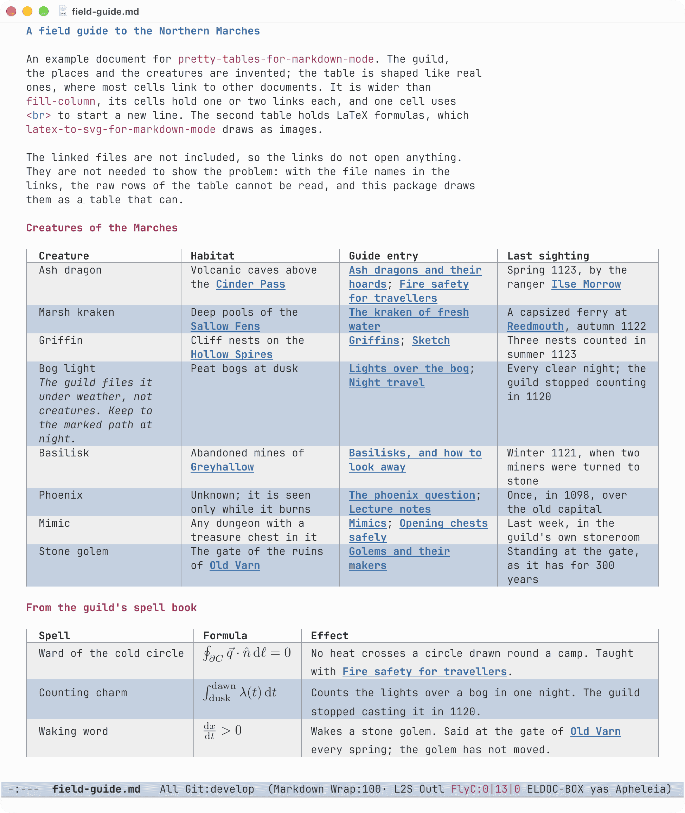
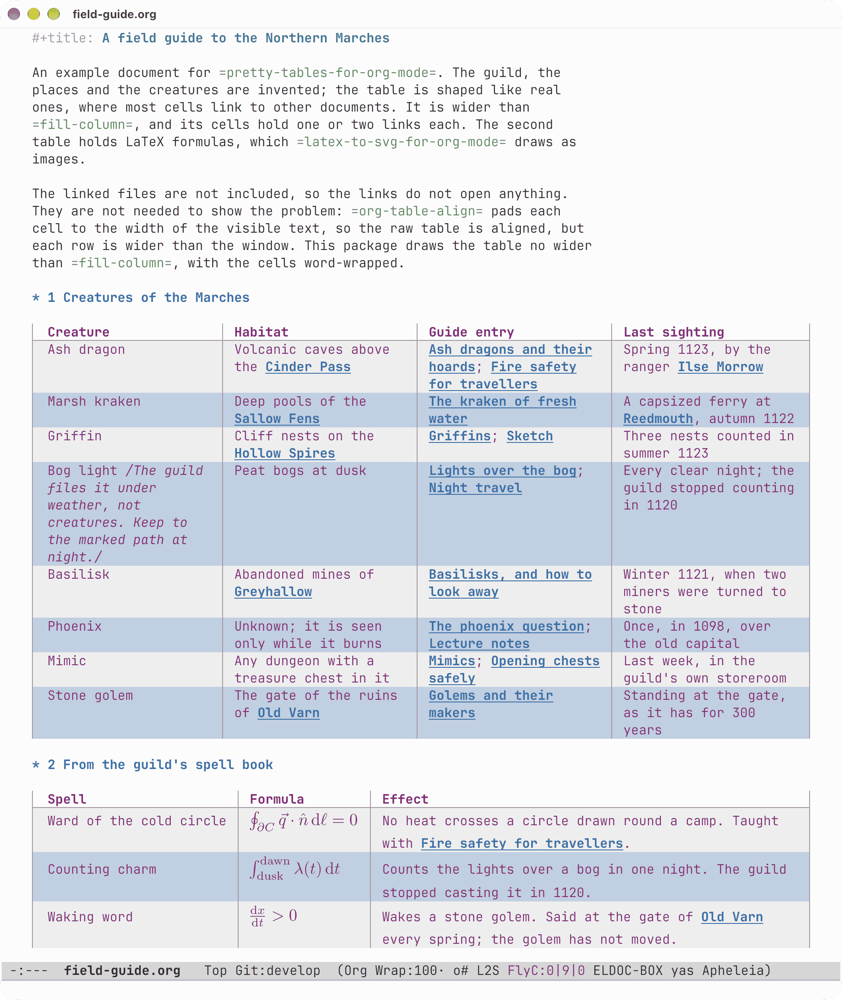
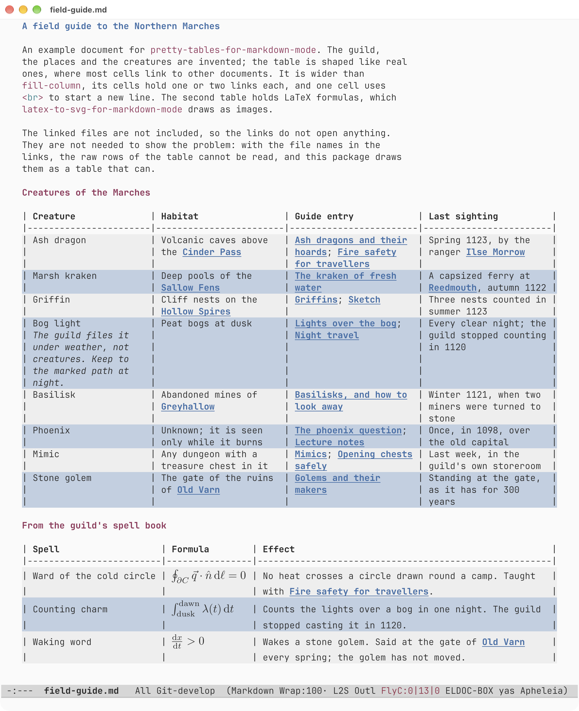
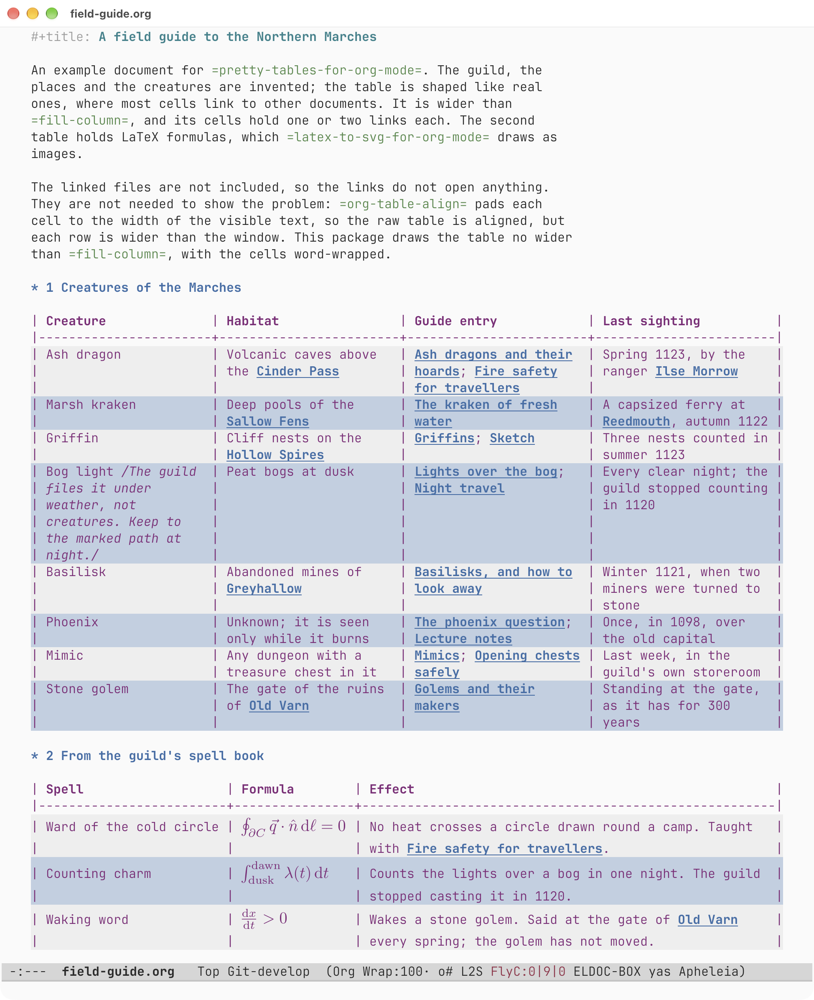

# pretty-tables.el


[](https://github.com/alberti42/pretty-tables.el/actions/workflows/melpazoid.yml)
[](https://github.com/alberti42/pretty-tables.el/actions/workflows/ci.yml)
[](LICENSE)

*pretty-tables* draws the tables of an Emacs buffer with aligned, wrapped columns. It changes how tables are displayed and nothing else: the buffer text is never modified. This repository ships three packages: *pretty-tables*, the drawing, and the two adaptors that use it:

- **pretty-tables-for-markdown**: provides *pretty-tables-for-markdown-mode*, prettifying the tables of *markdown-ts-mode*, which is bundled with Emacs 31.
- **pretty-tables-for-org**: provides *pretty-tables-for-org-mode*, prettifying the tables of *org-mode*.

Each mode is a buffer-local minor mode, and nothing of *markdown-ts-mode* or *org-mode* is replaced. *pretty-tables-for-org* advises *org-table-expand* and *org-table--shrink-columns*, so a table is drawn again when a column is shrunk or expanded.

Column widths come from the text a reader sees in each cell: characters that are invisible (for example link markup hidden by *markdown-ts-hide-markup*, or the hidden part of an Org link) take no room. When the table is wider than *pretty-tables-width*, the widest columns are narrowed and their cells are word-wrapped onto several screen lines. In Markdown, `<br>` in a cell starts a new line. LaTeX equations in a table cell are drawn as images with [*latex-to-svg*](https://github.com/alberti42/latex-to-svg); see [Images in cells](#images-in-cells).

On a graphical display the cells are measured in pixels, in the faces they are drawn with, so a variable-pitch font, or a character drawn in a fallback font, keeps the columns aligned; on a text terminal they are counted in columns. *pretty-tables-width* and *pretty-tables-min-column-width* are in columns; on a graphical display a column is the width of the font of the table face, *markdown-ts-table* or *org-table*. With *pretty-tables-borders* set to `ascii`, the `-` of a separator row can end up to one `-` short of the next `|` or `+`.

Disclosure: Written with AI assistance (Claude). Every change is reviewed and tested by the author, and design decisions are the author's.

## Why

A table is there to give an overview: the reader sees the rows and columns together and compares them. Markdown writes each table row on one line, and once the cells hold links, a row is several times wider than the window. Emacs can show such a row in two ways, and both lose the overview:

- With long lines wrapped, a row fills several screen lines, and nothing shows where one row ends and the next begins.
- With long lines truncated, each row stays on one line and the window shows only its first columns: the reader scrolls sideways to read a row and never sees the whole table.

The modes draw the table no wider than *pretty-tables-width* (by default *fill-column*), and no wider than the text area of the window. Each cell stays in its column and wraps inside it, hidden link markup takes no room, and data rows alternate their backgrounds, so each row can be told from the next. The buffer text is never modified, so the file stays a plain Markdown or Org table for every other tool.

Org writes each table row on one line too. *org-table-align* pads the cells in the buffer text, so a raw Org table is already aligned, but each row is as wide as its widest cells together. The gain in Org is the wrapping, and widths without the hidden part of the links.

The pipe tables of GitHub Flavored Markdown, which *markdown-ts-mode* reads, have no syntax for writing one row over several lines. A proposal to add one, with continuation lines that begin with `┆` or `|~`, is under discussion on the CommonMark forum: [Let table rows wrap over several lines](https://talk.commonmark.org/t/let-table-rows-wrap-over-several-lines/9133). It would fix the problem at its root, in the source text, so that a table could be read with no viewer such as this package. It is mentioned here only as that alternative: this package does not implement it, and draws only tables whose rows are written on one line each. The most likely outcome is that no such syntax is adopted. If one is, the files already written with one row per line remain, and they need a viewer for some time.

## Example

[`examples/field-guide.md`](examples/field-guide.md) and [`examples/field-guide.org`](examples/field-guide.org) hold the same invented field guide, in Markdown and in Org. The screenshots show them in a graphical frame, with the doom-opera-light theme, *fill-column* set to 100, *pretty-tables-borders* set to `lines`, and in Markdown the markup hidden with `C-c C-x C-m` (*markdown-ts-toggle-hide-markup*). The formulas of the second table are drawn by *latex-to-svg-for-markdown-mode* and *latex-to-svg-for-org-mode*.

**markdown-ts-mode**



**org-mode**



With *pretty-tables-borders* at its default, `ascii`, the lines between the cells are drawn with the characters `|`, `-` and `+`, or those of the adaptor's separator row.

<details>
<summary>The same tables drawn with <code>ascii</code></summary>

**markdown-ts-mode**



**org-mode**



</details>

## Requirements

- Emacs 31.1 or later.
- For *pretty-tables-for-markdown*: the *markdown-ts-mode* of Emacs 31, and the `markdown` and `markdown-inline` tree-sitter grammars, which *markdown-ts-mode* needs too. `M-x treesit-install-language-grammar` installs them.
- For *pretty-tables-for-org*: the Org bundled with Emacs.

All of these are part of Emacs or fetched by it; the packages need nothing else.

## Installation

The packages are not published yet. Clone the repository and add it to *load-path*:

```elisp
(use-package pretty-tables-for-markdown
  :load-path "~/path/to/pretty-tables"
  :hook (markdown-ts-mode-hook . pretty-tables-for-markdown-mode))

(use-package pretty-tables-for-org
  :load-path "~/path/to/pretty-tables"
  :hook (org-mode-hook . pretty-tables-for-org-mode))
```

With *straight.el*, from a local clone, one recipe per package, *pretty-tables* first:

```elisp
(use-package pretty-tables
  :straight (pretty-tables
             :type git
             :local-repo "~/path/to/pretty-tables"
             :files ("pretty-tables.el")))

(use-package pretty-tables-for-markdown
  :straight (pretty-tables-for-markdown
             :type git
             :local-repo "~/path/to/pretty-tables"
             :files ("pretty-tables-for-markdown.el"))
  :hook (markdown-ts-mode-hook . pretty-tables-for-markdown-mode))

(use-package pretty-tables-for-org
  :straight (pretty-tables-for-org
             :type git
             :local-repo "~/path/to/pretty-tables"
             :files ("pretty-tables-for-org.el"))
  :hook (org-mode-hook . pretty-tables-for-org-mode))
```

## Usage

`M-x pretty-tables-for-markdown-mode` or `M-x pretty-tables-for-org-mode` turns the mode on in the current buffer. Each is marked as a command of *markdown-ts-mode* or *org-mode*, so with *read-extended-command-predicate* set to *command-completion-default-include-p*, `M-x` offers it only in buffers of that mode or a mode derived from it. The hooks above turn it on in every *markdown-ts-mode* or *org-mode* buffer.

- The row point is on is shown as its raw text, so it can be edited and its links followed. In a read-only buffer it stays drawn, except during an Isearch; *pretty-tables-reveal* changes that. On a drawn row, point moves through the row's text as through raw text, and the cursor is on the drawn character that shows the text at point.
- While you type in that row, the other rows of the table keep their drawing; when point leaves the row, the table is drawn again with the widths of the new text. An edit that adds or deletes a newline, or changes another row, draws the table at once.
- After a scroll command, a row point moved onto stays drawn until the next command. A scroll command is one with a non-nil *scroll-command* property: *mwheel-scroll*, *pixel-scroll-precision*, *scroll-up-command*, *scroll-down-command* and the other scroll commands of Emacs.
- Clicking a character of a drawn row moves point to that character in the buffer, and follows the link there if there is one. In Markdown the link is followed with the command RET runs there; in Org it is opened with *org-open-at-point*.
- In Markdown, *markdown-ts-toggle-hide-markup* (`C-c C-x C-m`) shows and hides the markup; the tables are drawn again with the new widths.
- *pretty-tables-toggle-hook* runs when either mode is turned on or off, before the mode's own hook, so settings common to both modes go there:

  ```elisp
  (add-hook 'pretty-tables-toggle-hook
            (lambda ()
              (when (pretty-tables-active-p)
                (setq-local pretty-tables-width 'text-area))))
  ```
- *pretty-tables-redraw* draws the tables of the current buffer again, measuring its windows first. It is for a hook of a package that changes what the tables are drawn in, such as window margins, without running the window hooks; it ignores its arguments, so any hook can call it. The tables are drawn again by themselves when a window, a theme or the buffer's fonts change.

## Options

The options below and the faces belong to *pretty-tables*, so they apply to both modes. *pretty-tables-for-org-width-cookies* belongs to *pretty-tables-for-org*; see [Org tables](#org-tables).

|Option                          |Default|Meaning                                                                      |
|--------------------------------|-------|-----------------------------------------------------------------------------|
|`pretty-tables-width`           |`fill-column`|Maximum width, in columns, of a displayed table: `fill-column`, a number, or `text-area` for no width of its own. A table is never wider than the text area. On a graphical display a column is the width of the font of the adaptor's table face, such as `org-table`.|
|`pretty-tables-min-column-width`|`8`    |Width below which a column is not narrowed to fit the table width.           |
|`pretty-tables-stripe-rows`     |`t`    |Non-nil means data rows are drawn with alternating backgrounds.              |
|`pretty-tables-row-lines`       |`nil`  |Non-nil means a line is drawn under each data row but the last.              |
|`pretty-tables-borders`         |`ascii`|How the lines between the cells of a drawn table are drawn: `ascii` or `lines`.|
|`pretty-tables-separator-spacing`|`0.25`|Space between a row and the line of the separator row under it, in units of the height of a line of text. Used when `pretty-tables-borders` is `lines`.|
|`pretty-tables-image-spacing`   |`0.5`  |Most space above and below an image in a cell of a drawn table, in units of the height of a line of text, split evenly above and below the image.|
|`pretty-tables-image-spacing-factor`|`2`|Pixels of space per pixel an image reaches past the letters of the line. 0 means no space for any image; t means the most space for every image that reaches past the font, and none for one that fits within it; nil means the most space for every image.|
|`pretty-tables-reveal`          |`writable`|When the row point is on is shown as its raw text: `always`, `writable` (in a buffer that is not read-only) or `nil` (never). During an Isearch it is shown whatever the value.|

A table is also never wider than the text area of the narrowest window showing the buffer: the window without its margins and fringes, less the line numbers, less the column of the continuation glyph when the window has no fringes, and less the table's indentation and `line-prefix`. When that width changes, as when a window is resized or split or shows another buffer, the tables are drawn again. With *pretty-tables-width* set to `text-area`, a table takes the text area alone; in a buffer no window shows, that means *fill-column*.

Each width option bounds how far the columns are narrowed, and none of them widens a table. No column is narrowed below its floor: its Org width cookie, else *pretty-tables-min-column-width*, and never below its widest image. A table whose columns are all at their floors can be wider than the width.

Setting *fill-column* (`C-x f`) or one of these options draws the tables again in the buffers where a mode is on.

The options are safe as file-local and directory-local variables when their value has the option's type, so a file or a `.dir-locals.el` can set them without a prompt.

The first, third, ... data rows are drawn with the face *pretty-tables-row*, which has no background by default, so the rows show the buffer's; the others with *pretty-tables-stripe* and the background of *hl-line*, the face *hl-line-mode* highlights the current line with. Only the background is taken from *hl-line*. The theme sets it, for a light theme and a dark one alike, and the tables are drawn again when a theme is enabled. They are drawn again after a command that changes the buffer's face remapping, such as `text-scale-adjust` or *buffer-face-mode*, and after the frame's font is set. A background set on *pretty-tables-row* or *pretty-tables-stripe* takes the place of the theme's. The line is the underline of the face *pretty-tables-row-line*, so it takes no screen line of its own; in a terminal it is an ordinary underline. Both faces are added after the faces of the cell text, so a link or a code span keeps its own colours. The table face of the markup, *markdown-ts-table* or *org-table*, is added after them.

With *pretty-tables-borders* set to `lines`, the lines between the cells join from one screen line to the next, in the foreground of the face *pretty-tables-border*, which inherits *shadow*. On a graphical display a vertical line is 1 pixel wide and spans the whole height of each screen line, also a screen line made taller by an image; the background of a row ends at the lines at the left and right edges of the table. A separator row that follows a row other than a separator takes no screen line: it is hidden, and the row before it is underlined on the bottom pixel row of its last screen line, against the row below. *pretty-tables-separator-spacing* puts space between that row and the line, and the vertical lines cross it. Another separator row, such as an Org hline at the top of a table, is a horizontal line on the bottom pixel row of its own screen line. With *display-line-numbers*, the number of a hidden separator row is not shown. Point on a hidden separator row shows it as its raw text, as on any row. On a text terminal the lines are the box-drawing characters `│`, `─`, `├`, `┼` and `┤`. With `lines`, a Markdown delimiter row does not show the alignment of its columns.

The cell text of header rows is drawn with the face *pretty-tables-header*, which inherits *bold*; it too is added after the faces of the cell text. To draw the header without bold, remove the inheritance:

```elisp
(set-face-attribute 'pretty-tables-header nil :inherit 'unspecified)
```

The face *pretty-tables-header-row* covers the whole header row, pipes included, and sets nothing by default: a background set on it fills the row.

## Markdown: links and emphasis in table cells

*markdown-ts-mode* runs the `markdown-inline` grammar only on `inline` nodes, and a table cell is not one, so links, emphasis and code in a cell are not fontified and their markup is not hidden. While the mode is on, it runs the grammar on table cells too, and *markdown-ts-mode* fontifies them as it fontifies a paragraph. The mode adds this rule only when *treesit-range-settings* does not already run the grammar on table cells, so once *markdown-ts-mode* parses table cells itself, the mode adds nothing. Turning the mode off removes the rule.

## Org tables

- A column is aligned as *org-table-align* aligns it: by the first `<l>`, `<r>` or `<c>` cookie in it, or else to the right when the share of its non-empty cells that match *org-table-number-regexp* is at least *org-table-number-fraction*. A row of cookies is drawn as a data row.
- The rows above the first separator are the header when a data row follows that separator. A separator can stand between any two rows; the data rows on both sides alternate their backgrounds as if it were not there.
- Columns that *org-table-shrink* narrows are read as they are displayed, and the table is drawn again when a column is shrunk or expanded, for example with `C-c TAB` (*org-table-toggle-column-width*).
- When a table is wider than *pretty-tables-width*, the columns with a `<N>`, `<lN>`, `<rN>` or `<cN>` cookie are narrowed first, and none is narrowed below the width Org shows it at when the column is shrunk: N characters and *org-table-shrunk-column-indicator*. A table that fits keeps the natural widths of its columns. Setting *pretty-tables-for-org-width-cookies* (default `t`) to nil turns this off; setting it draws the tables again, and it is safe as a file-local variable.
- Text hidden by folding is read as if it were shown, so a table drawn while its heading was folded has the right widths when the heading is unfolded.
- Table.el tables, `#+TBLFM` lines, and lines starting with `|` in a source block are not drawn.
- A table whose `#+ATTR_ORG` sets `:pretty-tables` to nil is not drawn:

  ```org
  #+ATTR_ORG: :pretty-tables nil
  | a | b |
  ```
- In a narrowed buffer with *font-lock-dont-widen* set, a table that extends past the accessible portion is not drawn.
- The row point is on is shown raw, and *org-table-align* keeps that row aligned with the other raw rows, not with the drawn ones.

## Images in cells

LaTeX equations in a table cell are drawn as images with [*latex-to-svg*](https://github.com/alberti42/latex-to-svg), which shows LaTeX math as SVG images. Its adaptors work with these modes:

- [*latex-to-svg-for-markdown*](https://github.com/alberti42/latex-to-svg/blob/main/docs/latex-to-svg-for-markdown.md), for *markdown-ts-mode*, with *pretty-tables-for-markdown-mode*;
- [*latex-to-svg-for-org*](https://github.com/alberti42/latex-to-svg/blob/main/docs/latex-to-svg-for-org.md), for *org-mode*, with *pretty-tables-for-org-mode*.

An equation takes the width of its image, and its column is not narrowed below it. The row point is on shows the LaTeX source, as every raw row does. This needs *latex-to-svg* 0.21.0 or later, which requires *latex-to-svg-backend* 0.14.0; with earlier versions, a drawn row shows the LaTeX source.

A package that shows text as an image, with an overlay whose *display* is the image, can have the image drawn in a table too. The image is measured as it is displayed, so its spec needs no `:width`; it takes its width in the cell, and its column is not narrowed below it. On a display that cannot show images, the cell shows the text under the overlay.

An image in a cell is drawn with space above and below it, so an equation taller than a line of text, such as a fraction, does not touch the rows above and below it. The most space is *pretty-tables-image-spacing* (default 0.5) times the height of a line of text, split evenly above and below the image. An image gets this space only as far as it reaches past the letters of the line: one that fits within the font's ascent and descent gets none, so its row is no taller than a row of text, and one that reaches past them by a few pixels gets *pretty-tables-image-spacing-factor* (default 2) times as many. With the factor 0 no image gets space; with t every image that reaches past the font gets the most space, and one that fits gets none (an image reaches past the font by a whole number of pixels, at least 1, so a factor at least as large as the most space in pixels, such as 1000, gives the same result as t); with nil every image gets the most space, also one that fits. It is a vertical `:margin` of the copy of the image that draws it, and the copy's `:ascent` is changed so that the image stays on the same baseline. An image that already has a `:margin` is left as it is.

A table is drawn when jit-lock reaches it, so an image that appears or changes after that is not in the drawing. The package then calls *jit-lock-refontify* from the start of that overlay, the one with the property *pretty-tables* that covers the image's text, and the table is drawn again at the next redisplay. Redisplay does not reach the text under a drawn row, so marking only the image's text does nothing until point enters the row. *latex-to-svg* does both for its equations.

## Hiding link markup with spaces

A configuration that hides link markup with `(space :width N)`, to keep raw tables aligned, makes that markup count as N spaces here. Such a configuration should use *invisible* while a mode is on.

## Writing an adaptor

To draw the tables of another major mode, such as another markup like reStructuredText or a buffer of your own package that shows tables, write an adaptor: a minor mode that finds the tables of that major mode. Define it with the macro *pretty-tables-define-mode*. This defines the minor mode `pretty-tables-for-rst-mode`, for the tables of `rst-mode`:

```elisp
(pretty-tables-define-mode pretty-tables-for-rst-mode
  "Display reStructuredText tables with aligned, wrapped columns."
  :interactive (rst-mode)
  :tables #'pretty-tables-for-rst--tables
  :separator #'pretty-tables-for-rst--draw-separator)
```

The first argument is the name of the mode, used as given, and the second its docstring. The functions `pretty-tables-for-rst--tables` and `pretty-tables-for-rst--draw-separator` are yours to write. The keys:

- `:tables` (required): a function called with BEG and END that returns each table overlapping that region: the bounds of the table and of each row, the kind of each row (header, separator or data), the bounds of each cell, an alignment per column, and optionally a minimum width per column.
- `:separator` (required): a function that returns the string drawing a separator row.
- `:face`, `:line-break`, `:invisible`, `:follow`, `:prefix`, `:options` (optional): described in the docstring of *pretty-tables-enable*, the function the mode calls when it is turned on. *pretty-tables-disable* is called when it is turned off.
- Any other key, such as `:interactive`, is passed to *define-minor-mode*.

Forms after the keys run each time the mode is turned on or off, before the tables are drawn or removed. The Org adaptor uses them to add and remove a hook of its own.

An adaptor of a buffer that shows Org tables outside *org-mode* can call *pretty-tables-for-org-table* with the position of the first `|` of each row, and pass *pretty-tables-for-org-draw-separator* as `:separator`.

## Tests

```sh
make test
```

The tests run in `emacs --batch --quick`. The tests of *pretty-tables-for-markdown* need the `markdown` and `markdown-inline` grammars and are skipped without them.

The CI workflow installs both grammars and runs byte-compilation, checkdoc and the tests on Emacs 31.1 and on Emacs master. The melpazoid workflow runs the checks MELPA's reviewers run, once per package.

## Versions and changes

The three packages share one version number. Version numbers follow [Semantic Versioning 2.0.0](https://semver.org/spec/v2.0.0.html). [`CHANGELOG.md`](CHANGELOG.md) follows [Keep a Changelog 1.1.0](https://keepachangelog.com/en/1.1.0/), and the text of each GitHub release is its version's section there.

## Verifying a release

Each GitHub release carries `pretty-tables-X.Y.Z.tar.gz`, built from the tag with `git archive`, the files `pretty-tables.el`, `pretty-tables-for-markdown.el` and `pretty-tables-for-org.el`, and `SHA256SUMS`. The release workflow attests the provenance of all but `SHA256SUMS`: a signed statement that the workflow produced these bytes from the tag's commit. To check a downloaded file:

```sh
gh attestation verify pretty-tables-X.Y.Z.tar.gz --repo alberti42/pretty-tables.el
```

`SHA256SUMS` only shows that a download is not corrupted, because it is published beside the files it describes. The attestation is kept in GitHub's attestation store, so replacing a release asset does not replace its attestation.

## License

GPL-3.0-or-later. Copyright (C) 2026 Andrea Alberti.
